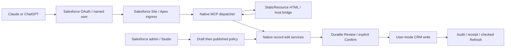

# Cardstack architecture and deployed inventory

> **Current status — October 15:** Case editing, explicit record discovery, related-list navigation and controlled recovery/stale-result checks passed in both hosts; combined source is `a9a304e`. Flow OAuth and managed user/org verification succeeded; Studio acquisition/compilation is being tested. Lookup remains unsupported. See [overnight progress and current evidence](OVERNIGHT_PROGRESS_2026-10-15.md). Earlier inventory and test results below retain their dated scope.


Evidence reviewed October 14, 2026. This is a read-only documentation audit; no deploy, org setting change, CRM write, infrastructure change or test run was performed for this audit.

## The current system

Cardstack lets a Salesforce administrator publish the record fields, sections, actions and policies that a connected Salesforce user can use inside AI chat. Salesforce owns configuration, execution, validation, authorization, review, confirmation, audit and durable receipts. Local Node builds bundle HTML assets; they are not the selected runtime host. The currently installed beta's Hosted MCP/HXL route and the newer Salesforce Site/custom MCP Apps route coexist in the development org. HXL retirement remains the selected direction; coexistence during migration is not proof that every historical surface has been retired.

The primary checkout is an older product snapshot. At audit time it is main `451ba213a2b0f6dc3744a7a5b106f4cb6ef07fdc`. The current integration checkout is `integration worktree`, branch `codex/cardstack-integration`, HEAD `b55db76`. Its deployed application milestone is `5275b7e`. Other retained worktrees are `studio-admin-experience` (`1fbc89b`) and `dynamic-lookup` (`94035dd`); their existence is not deployment evidence. Do not plan implementation from primary README limits without consulting the newer integration source and evidence.

## Architecture layers

| Layer | Native implementation | Responsibility |
| --- | --- | --- |
| Admin experience | `cardstackStudio` LWC; `CardstackStudioController`; connection setup controller | Configure objects, layouts, record actions, flow launch cards, draft/publish, client setup and checks |
| Policy/configuration | `CardstackConfigService`, `CardstackPolicyService`, record-action policy/services | Published policy can restrict Salesforce access, never expand it; drafts do not authorize writes |
| Existing beta delivery | Hosted MCP definition, Lightning types, HXL uiWidgets | 17 community tools; record/list/home/confirmation/editor/flow-launch presentation |
| Current custom transport | `CardstackMcpIngress`, `CardstackMcpDispatcher` | Salesforce Site public discovery/challenge; named-user bounded JSON-RPC requests and native tool/resource dispatch |
| Custom app delivery | `CardstackEditorUiResource`, Record/Opportunity MCP adapters, Salesforce StaticResources | Self-contained HTML with SDK 1.7.4 and host bridge; current UI URI binds SHA256 of installed bytes |
| Record work | `CardstackRecordEditService`, `CardstackRecordScreenCapability`, native picklist provider | Native configured record descriptor, supported field controls, draft/review/confirm/refresh |
| Opportunity work | Opportunity domain, repository, selector, stage provider, write service and MCP adapter | Typed Opportunity editing and governed native writes; existence does not establish full flow-engine parity |
| Durable data | Config, Draft, Confirmation, Interaction, Audit objects; newer connection setup/diagnostic and edit storage | Server-owned authorization/revision/freshness and receipt state; private state is not a user CRUD surface |
| Salesforce CRM | User-mode SOQL/DML plus sharing, CRUD/FLS, validation and automation | Connected user's actual object, field and record authority |

Source citations: [older native package README](../README.md), [record actions](RECORD_ACTIONS.md), and current integration [dispatcher](../force-app/main/default/classes/CardstackMcpDispatcher.cls), [ingress](../force-app/main/default/classes/CardstackMcpIngress.cls), [UI registration](../force-app/main/default/classes/CardstackEditorUiResource.cls).



Custom transport has exact per-client `/services/apexrest/cardstack/v1/claude/mcp` and `/chatgpt/mcp` routes beneath the configured Site prefix, each with a sibling `/metadata`. Public metadata returns the exact protected resource and Salesforce issuer. Anonymous tool/resource requests receive 401; named users need Use permission and current enabled setup. POST handles bounded single JSON-RPC objects, not arbitrary batch requests. Client route identifies setup state, not cryptographic attestation of which OAuth app issued the token. Salesforce handles bearer validation; custom code does not forward, decode or refresh tokens. See [current install guide](MCP_APPS_INSTALL.md).

The dispatcher advertises diagnostic open/echo plus four record tools and four Opportunity tools: open, edit start, edit transition, refresh. App visibility and private `_meta` carry interaction details; model-facing content and UI data are different channels. Installed resource bodies determine immutable current addresses; historical aliases are mutable compatibility reads. Old conversations can retain stale resources: Claude's October 14 acceptance needed a fresh conversation after tool refresh, without reconnecting OAuth.

## Live Salesforce inventory

Read-only CLI queries used explicit API67 and `cardstack-spike2`. Package inspection confirms Cardstack **0.1.0.8** remains installed. That artifact version does not describe later source deployments over the unlocked package. Runtime contract `0.1.0.8` displayed by setup is also not an installed-artifact inventory.

Live class query found **121 Cardstack Apex classes**, all compiled for API67. A second query privately compared Body against current integration source: **117 source class bodies matched after stripping surrounding whitespace**, zero differing bodies, zero source-only classes. Four org-only historical probe classes remain: `CardstackInputBoundaryAction`, `CardstackMcpTransportProbeTest`, `CardstackSiteAuthProbe`, `CardstackSiteAuthProbeTest`. This comparison proves Apex body alignment, not complete metadata/permission/settings equality.

One Site was returned: **CardstackAuthDiscoveryProbe — Active**. Current persistent runtime activity supersedes the earlier disposable install-QA cleanup statement. Five Cardstack HTML resources were returned:

| StaticResource | Last modified UTC |
| --- | --- |
| CardstackMcpTransportProbeUi | 2026-10-08 14:07:48 |
| CardstackConnectionDiagnosticUi | 2026-10-13 20:17:25 |
| CardstackOpportunityEditUi | 2026-10-14 15:44:07 |
| CardstackOpportunityPreviewUi | 2026-10-14 15:44:07 |
| CardstackRecordEditUi | 2026-10-14 15:44:07 |

Resource inventory did not re-fetch HTML bodies or requalify host execution. Existing independent retrieval evidence supplies those stronger claims. OAuth secrets, setup payloads, actor identifiers and private keys were not read into this document. Current OAuth policy and guest-grant equality were not independently rechecked by this audit.

Machine-readable sanitized observation (no private IDs or credentials):

```json
{
  "observedDate": "2026-10-14",
  "mode": "read-only",
  "salesforce": {
    "alias": "cardstack-spike2", "apiVersion": "67.0",
    "installedCardstackArtifact": "0.1.0.8",
    "cardstackClassCount": 121,
    "sourceBodiesMatchingAfterTrim": 117,
    "differentBodies": 0, "sourceOnlyClasses": 0,
    "orgOnlyHistoricalClasses": 4,
    "siteState": "Active", "htmlStaticResourceCount": 5
  },
  "railway": {
    "project": "cardstack", "environment": "production",
    "onlineServices": 3, "runningReplicas": 3,
    "postgresVolumeMB": 500, "buckets": 0,
    "recentFailures": 0, "postgresWarnings": 1,
    "emptyHistoricalPendingPatchObserved": true
  }
}
```

## Evidence progression and what is qualified

1. Installed community beta 0.1.0.8: HXL Account text/integer and published action journeys proved in Claude, 167 fresh installed tests and 172 development tests reported. Companion HXL/Lightning/MCP setup required. This is historical beta proof, not the current custom renderer scope ceiling. [Package guide](../package/UNLOCKED_PACKAGE.md).
2. October 8 synthetic Salesforce-only HTML/bridge proof passed actual Claude and ChatGPT. [Auth runbook](MCP_APPS_AUTH_RUNBOOK.md) documents route-specific opaque-token requirement and distinction from deployment app JWT restoration.
3. Unreleased validation artifact 0.1.0.10 from `394cdb7`: 88% actual package coverage, fresh installation, 332/332 installed Apex and 124 local tests; actual two-client synthetic UI and natural OAuth refresh. Disposable installation/clients/org were cleaned up. Direct wire rejection of client-held revoked tokens and rotation remained unmeasured. Historical 0.1.0.9 UI receipt failure remains separate evidence. [Install QA](MCP_APPS_INSTALL_AUTH_QA.md).
4. October 14 persistent workspace application `5275b7e`: qualified baseline `3daad61` passed **808/808 native methods**, **90.38% aggregate coverage**; final three-StaticResource presentation delta passed **124/124** native resource/adapter checks and **93** renderer/contract checks. Independent metadata reconciliation reported 329 files and final six UI files exact. Ten-field configured Lead editing passed validation, Back/re-review, explicit Confirm, receipt, Refresh and independent readback in both clients; one save per host. Draft and reviewed cancellation produced zero extra writes/audits. This supersedes the earlier “governed custom CRM writes unproved” statement for that verified slice. [Persistent record workspace](PERSISTENT_RECORD_WORKSPACE_2026-10-14.md).

Do not convert a deployed development-org source delta into a new released/fresh-installed package claim. The final UI delta did not rerun another full 808-method suite; unchanged native baseline qualification and focused UI tests are the recorded evidence. Known-ID open, supported scalar descriptors and the verified Lead journey do not establish natural name disambiguation, full Salesforce Screen Flow execution or universal object/field compatibility. REFERENCE lookup remains unsupported pending native qualification. Actual-host lost Confirm response and delayed stale-record-switch faults remain NOT_RUN. [Lookup qualification](LOOKUP_NATIVE_QUALIFICATION_2026-10-14.md).

## Retired Railway infrastructure is still running

Architectural retirement has **not** meant infrastructure decommissioning. Read-only Railway `list-projects`, `list-services`, `describe-environment` and `environment-status` found one cardstack production environment with all three services **Online**, each one running replica in `us-east4-eqdc4a`:

| Resource | Current provider observation | Latest deployment created UTC |
| --- | --- | --- |
| @cardstack/mcp-server | Online; DMB28th/Re-headed-crm main | 2026-08-11 21:04:33.480 |
| @cardstack/studio | Online; same repository/main | 2026-08-11 21:04:33.101 |
| Postgres | Online; postgres-ssl:18 image | 2026-08-23 02:12:27.810 |
| postgres-volume | 500 MB mounted `/var/lib/postgresql/data` | Not a deployment |

No buckets or shared variable names were reported. Health reported zero recent failures, one Postgres warning (cause not inspected), and an empty historical staged patch dated July 11. Environment inventory said no staged changes; health exposed that zero-change pending record. No pending mutation was accepted. Provider Online state is not end-to-end CRM/OAuth/UI QA, and does not mean this retired stack is a supported current product path. Variables, database contents, logs and billing were not queried. No service was restarted or removed. Decisions about decommissioning require a separate explicit action, since retained data and old users/connections were not audited here.

## Deployment and distribution constraints

API67 is the documented deployment target. Deployment Card Stack SFAPP must end JWT ON; proven Site runtime OAuth apps are separate and issue opaque tokens. Core package stages exclude org-specific Sites, ECAs, OAuth settings and secrets. Current subscriber onboarding still requires per-org Site/OAuth/access setup; historical HXL companion restrictions remain relevant to beta distribution. No new package release, promotion or universal onboarding acceptance follows from this documentation audit.

## Chat sources inspected

- `01a11ba7-7312-7441-8539-61398a72b8da`, **Approve MCP Apps migration spec**: handoff to separate install/auth gate work.
- `01a12500-2f98-7f80-bcfd-e2c504786489`, **Cardstack production auth and installation…**: final handoff records 0.1.0.10 evidence, cleanup and then-unapproved Opportunity design. Subsequent persistent-workspace evidence/source supersedes that earlier product-status checkpoint.

The chat reads here were focused recent handoffs, not exhaustive pagination of every underlying tool event. Historical claims are grounded in linked sanitized receipts and current source, while the project-wide chat/material inventory is maintained by the coordinating documentation audit.

## October 15 deployment and architecture reconciliation

The source baseline is now committed as `a9a304e`. The combined v6 developer QA deployment added discovery, related-list policy/read/navigation services, exact historical-resource archives and a bounded native Flow compiler/plan/service/provider. Subsequent five-class related compatibility and four-class Flow report patches were deployed/read back independently. The original 121-class/five-resource inventory above predates those additions and was not re-queried for this refresh.

A dedicated Salesforce-managed per-user Flow metadata connection is now authorized; an actual Apex call verified expected QA user/org. Admin metadata acquisition is separate from ordinary runtime: interpreted transitions consume a published immutable plan rather than fetching Tooling metadata. Actual Studio acquisition/compilation is in progress, not yet a proved interpreted journey. Lookup's dedicated connection/qualification remains separate and unproved.

The deployed developer QA renderer includes explicitly enabled response-fault controls. Normal local resources/demos were restored and checked, but that does not establish a normal-resource org cutover. Host Case, related navigation and controlled recovery acceptance apply to the recorded QA hashes. Latest exact deployment, regression and client boundaries are in [overnight progress](OVERNIGHT_PROGRESS_2026-10-15.md). No new full-suite, fresh-install or release claim follows.
